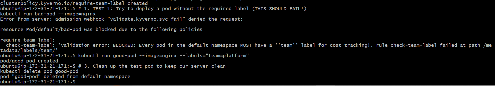
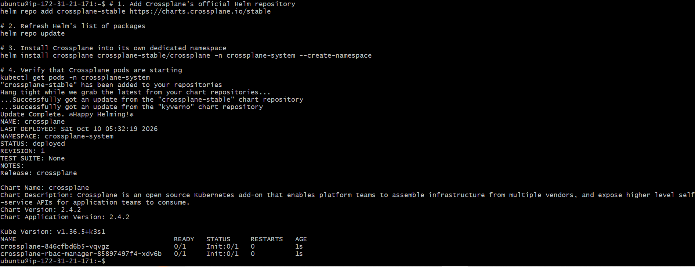
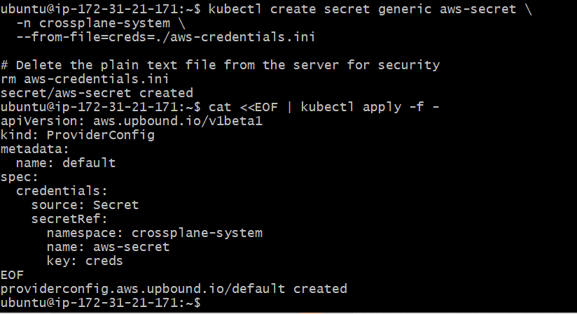
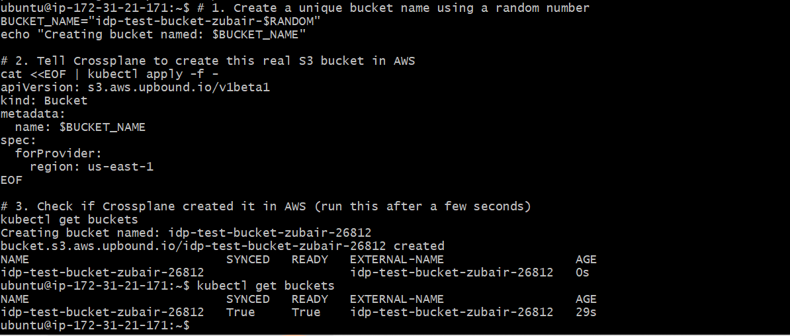
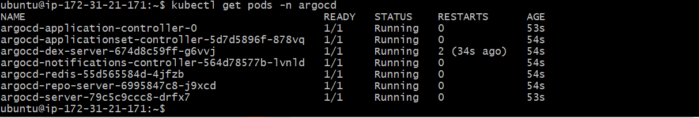
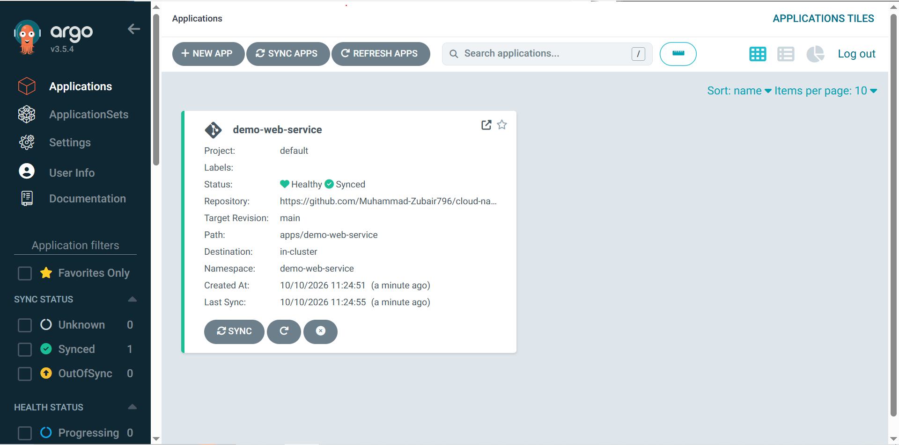
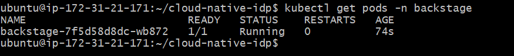
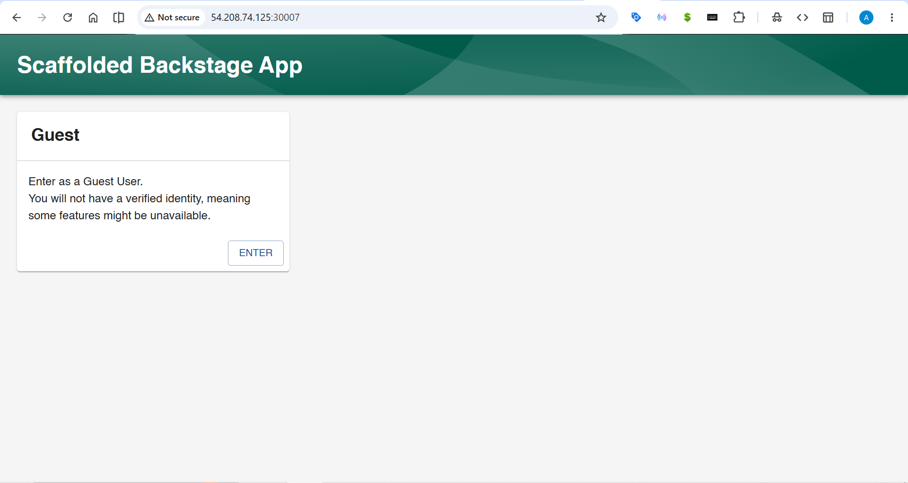
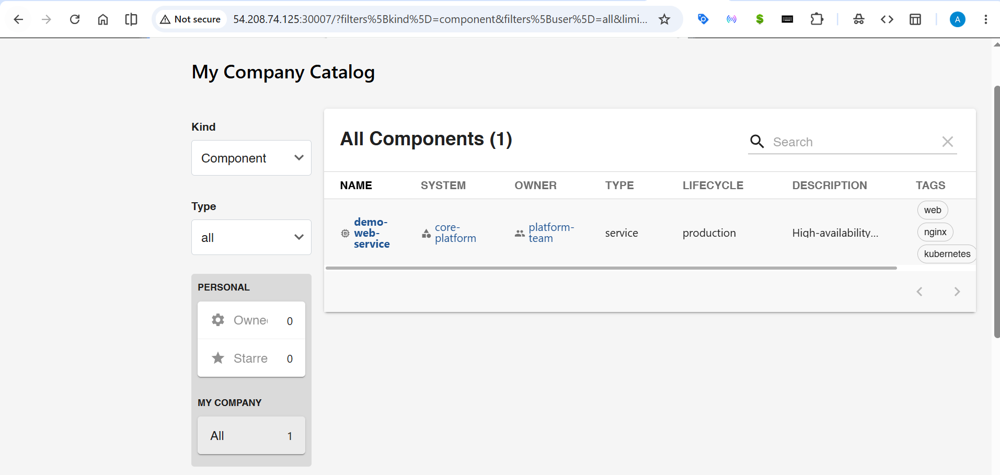

# 🚀 Enterprise Cloud-Native Internal Developer Platform (IDP)

An enterprise-grade **Internal Developer Platform (IDP)** designed to drastically reduce cognitive load on software engineers, eliminate infrastructure ticket bottlenecks, and establish standardized "Golden Paths" for cloud-native delivery.

Built directly on top of **Kubernetes** and **Amazon Web Services (AWS)**, this platform unifies self-service developer portals, dynamic multi-tenant GitOps delivery, cluster security guardrails, and cloud infrastructure control planes into a single automated ecosystem.

---

## 🏛️ Architecture Overview

<pre><code>
                                  +-----------------------------+
                                  |     Software Developer      |
                                  +--------------+--------------+
                                                 |
                                 1. Self-Service Portal / Catalog
                                                 v
                                  +-----------------------------+
                                  |      Spotify Backstage      |
                                  |    (Internal Dev Portal)    |
                                  +--------------+--------------+
                                                 |
                                        2. Git Commit / Push
                                                 v
                                  +-----------------------------+
                                  |         GitHub Repo         |
                                  |    (Single Source of Truth) |
                                  +--------------+--------------+
                                                 |
                                     3. Dynamic Discovery
                                                 v
                                  +-----------------------------+
                                  |     ArgoCD ApplicationSets   |
                                  |        (GitOps Engine)      |
                                  +--------------+--------------+
                                                 |
                                       4. Cluster Delivery
                                                 v
                   +-------------------------------------------------------------+
                   |                 Kubernetes Cluster (AWS EC2)               |
                   |                                                             |
                   |   +-----------------------+     +-----------------------+   |
                   |   |   Kyverno Engine      |     |  Crossplane Control   |   |
                   |   | (Policy Guardrails)   |     |    (AWS Provider)     |   |
                   |   +-----------+-----------+     +-----------+-----------+   |
                   +---------------|-----------------------------|---------------+
                                   |                             |
                       Enforces Security             Provisions Cloud Resources
                                   v                             v
                   +-----------------------+         +-----------------------+
                   | Standardized Pods/Apps|         |   Real AWS Storage    |
                   |    (demo-web-service) |         |      (Amazon S3)      |
                   +-----------------------+         +-----------------------+
</code></pre>

---
## 📸 Visual Architecture & Proof of Execution

<b>1. Security Guardrails: Kyverno Policy-as-Code Admission Enforcement</b>

> Automatic rejection of non-compliant pods followed by admission of compliant workloads with cost-allocation labels.

<b>2. Cloud Abstraction: Crossplane Core & AWS Provider Setup</b>

> Installing Crossplane via Helm and configuring secure AWS IAM credential delegation via ProviderConfig.

<b>3. Live Cloud Reconciliation: Declarative AWS S3 Bucket Provisioning</b>

> Native Kubernetes custom resource (`Bucket`) reconciled live in AWS (`SYNCED: True`, `READY: True`).

<b>4. GitOps Delivery at Scale: ArgoCD ApplicationSets Auto-Discovery</b>

> ArgoCD controllers dynamically detecting `apps/demo-web-service` and syncing it into a dedicated namespace.

<b>5. Internal Developer Portal: Spotify Backstage & Service Catalog</b>

> Single pane of glass for engineers, complete with guest authentication and live ingestion of software catalog components.

---

## 🧩 The Four Platform Pillars

### 1. Self-Service Portal & Service Catalog (Spotify Backstage)
* **Single Pane of Glass:** Provides developers with a unified software catalog tracking system ownership, lifecycle state (`production`, `experimental`), and runtime health.
* **Stateful Backend:** Backed by an isolated **PostgreSQL** database ensuring high-availability persistence of entity graphs, plugin data, and migrations.
* **Golden Path Scaffolder:** Parameterized self-service templates allow developers to generate complete microservices, CI/CD configs, and cloud resources without writing boilerplate.

### 2. GitOps Automation at Scale (ArgoCD ApplicationSets)
* **Dynamic Git Directory Generators:** Monitors the `apps/` directory tree in Git. When any new folder is committed, an isolated application deployment is generated automatically.
* **Tenant Isolation:** Automatically routes microservices into their own dedicated Kubernetes namespaces (`apps/<service-name>` -> `namespace: <service-name>`).
* **Continuous Reconciliation & Self-Healing:** Enforces zero drift between declarative Git state and runtime state, pruning deleted components and correcting out-of-band cluster modifications.

### 3. Policy-as-Code & Automated Governance (Kyverno)
* **Admission Control Guardrails:** Validates, mutates, and blocks insecure Kubernetes resource manifests before they ever execute inside the cluster.
* **Cost & Ownership Auditing:** Enforces strict metadata requirements (`team` and `owner` labels) across all namespaces, rejecting untracked workloads automatically.

### 4. Cloud Infrastructure Abstraction (Crossplane)
* **Kubernetes as a Universal Control Plane:** Extends the Kubernetes API to manage external AWS cloud resources directly through declarative YAML manifests.
* **Modular Provider Integration:** Implements Upbound's modular AWS S3 Provider, authenticating via Kubernetes Secrets and IAM least-privilege delegation.
* **Full Lifecycle Management:** Provisions live AWS S3 buckets when manifests are applied and automatically destroys them when manifests are pruned.

---

## 📁 Repository Structure

<pre><code>
cloud-native-idp/
├── platform/                     # Platform Operations (Platform Team Only)
│   ├── kyverno/                  # Policy-as-Code Engine & ClusterPolicies
│   │   └── require-team-label.yaml
│   ├── crossplane/               # Cloud Control Plane Configurations
│   │   ├── provider-aws-s3.yaml
│   │   └── provider-config.yaml
│   ├── argocd/                   # GitOps Automation at Scale
│   │   └── applicationset.yaml
│   └── backstage/                # Internal Developer Portal & Database
│       └── backstage.yaml
├── templates/                    # Golden Path Scaffolding Blueprints
│   └── golden-path-service/      # Self-Service Microservice Template
│       ├── template.yaml         # Backstage Scaffolder definition
│       └── skeleton/             # Boilerplate files injected for developers
│           ├── catalog-info.yaml
│           ├── deployment.yaml
│           └── bucket.yaml
└── apps/                         # Tenant Workloads (Auto-Discovered by GitOps)
    └── demo-web-service/         # Production-ready microservice
        ├── catalog-info.yaml
        └── deployment.yaml
</code></pre>

---

## 🔄 The End-to-End "Golden Path" Lifecycle

1. **Self-Service Initiation:** A developer logs into the Backstage portal (`http://<SERVER-IP>:30007`) and navigates to the **Create** tab.
2. **Template Execution:** The developer selects the **Cloud-Native Microservice (Golden Path)** template, specifying the service name and owning team.
3. **Automated Scaffolding:** Backstage renders the template and commits the generated codebase into `apps/<new-service>/` within the central repository.
4. **GitOps Auto-Discovery:** ArgoCD's `ApplicationSet` controller detects the new directory, generates an `Application` resource, and initiates cluster deployment.
5. **Policy Admission Check:** Kyverno inspects the deployment pod specs. Because the Golden Path automatically attaches `team: <owner>`, the deployment is validated and admitted.
6. **Cloud Resource Provisioning:** Crossplane intercepts the `Bucket` manifest and executes authenticated API calls to AWS to spin up a production-ready Amazon S3 bucket.

---

## 🛠️ Reproduction & Deployment Guide

### Prerequisites
* 1x Ubuntu 22.04/24.04 EC2 Instance (Recommended: `t3.large` or `m7i-flex.large`, 2 vCPU, 8 GB RAM, 30 GB SSD).
* AWS Security Group Ports: `22` (SSH), `30007` (Backstage UI), `31293` (ArgoCD HTTPS), or open NodePort range `30000-32767`.
* Git and AWS IAM Access Keys with S3 permissions.

### 1. Cluster Foundation (k3s Kubernetes)
<pre><code>
curl -sfL https://get.k3s.io | sh -
mkdir -p ~/.kube
sudo cp /etc/rancher/k3s/k3s.yaml ~/.kube/config
sudo chown -R ubuntu:ubuntu ~/.kube
sudo chmod 644 /etc/rancher/k3s/k3s.yaml
</code></pre>

### 2. Package Management (Helm)
<pre><code>
curl https://raw.githubusercontent.com/helm/helm/main/scripts/get-helm-3 | bash
</code></pre>

### 3. Deploy Policy Guardrails (Kyverno)
<pre><code>
helm repo add kyverno https://kyverno.github.io/kyverno/
helm repo update
helm install kyverno kyverno/kyverno -n kyverno --create-namespace
</code></pre>

### 4. Deploy Cloud Abstraction (Crossplane)
<pre><code>
helm repo add crossplane-stable https://charts.crossplane.io/stable
helm repo update
helm install crossplane crossplane-stable/crossplane -n crossplane-system --create-namespace
</code></pre>

### 5. Deploy GitOps Engine (ArgoCD)
<pre><code>
kubectl create namespace argocd
kubectl apply -n argocd --server-side --force-conflicts -f https://raw.githubusercontent.com/argoproj/argo-cd/stable/manifests/install.yaml
kubectl patch svc argocd-server -n argocd -p '{"spec": {"type": "NodePort"}}'
</code></pre>

### 6. Deploy Backstage Portal & PostgreSQL
<pre><code>
kubectl apply -f platform/backstage/backstage.yaml
</code></pre>

---

## 🧪 Validation & Proof of Execution

| Component | Test Scenario | Observed Output |
| :--- | :--- | :--- |
| **Kyverno** | Deploy an unlabelled pod (`kubectl run test --image=nginx`) | <pre><code>Error from server: BLOCKED: Every pod in the default namespace MUST have a 'team' label for cost tracking!</code></pre> |
| **Kyverno** | Deploy a compliant pod (`--labels="team=platform"`) | <pre><code>pod/good-pod created (Admission Successful)</code></pre> |
| **Crossplane** | Apply declarative AWS `Bucket` YAML | <pre><code>NAME: idp-test-bucket   READY: True   SYNCED: True (Live in AWS Console)</code></pre> |
| **ArgoCD** | Commit `apps/demo-web-service` to GitHub `main` | <pre><code>demo-web-service   Synced   Healthy (Auto-Discovered & Deployed)</code></pre> |
| **Backstage** | Register entity via `catalog-info.yaml` | Service appears live in Backstage UI with ownership, system, and tags |

---

## 🧹 Teardown & Cost Optimization

To immediately stop all cloud consumption once testing is complete:
<pre><code>
# 1. Prune all Crossplane cloud resources (triggers automatic deletion of AWS S3 buckets)
kubectl delete buckets --all

# 2. Terminate the AWS EC2 Host Instance from AWS CLI or Console
aws ec2 terminate-instances --instance-ids &lt;YOUR_INSTANCE_ID&gt;
</code></pre>

---

## 👨‍💻 Platform Author

**Muhammad Zubair**  
*Software, DevOps & Platform Engineer*  
* **GitHub:** [@Muhammad-Zubair796](https://github.com/Muhammad-Zubair796)  
* **Specialization:** Kubernetes, Cloud-Native Architecture, Internal Developer Platforms (IDP)
